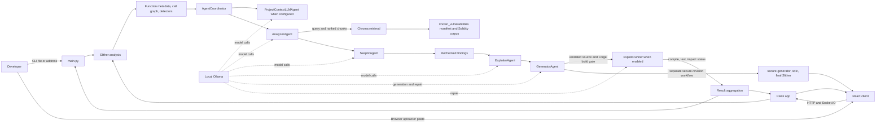
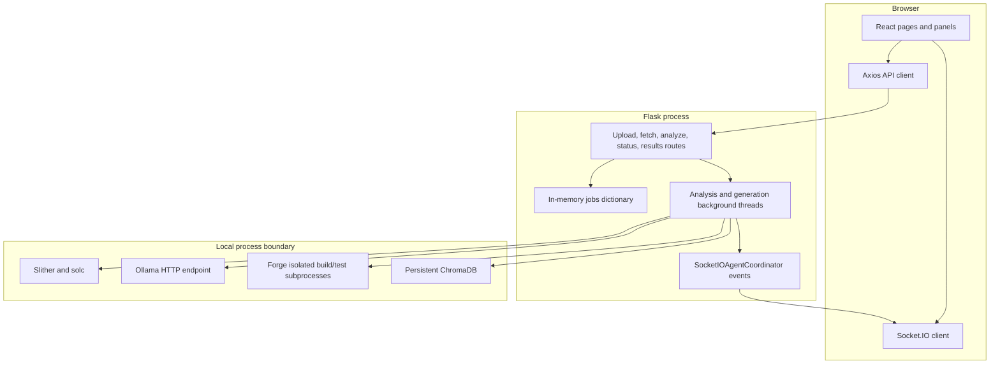
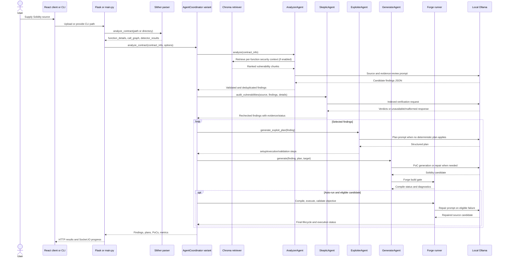

# SmartContractGuardian (VLD): Architecture and Execution Path

This document describes the implementation in this repository. It distinguishes code paths that are present from paths that were verified only by source inspection. Paths below are repository-relative unless stated otherwise. No secret values are included.

## 1. Project Overview

SmartContractGuardian accepts Solidity source, runs Slither-based structural and detector analysis, uses local LLM agents to produce and re-check candidate findings, optionally plans and builds Foundry proof-of-concept tests, and returns results through either a command-line report or the Flask/React application. A separate workflow generates a revised contract and checks it with deterministic source rules, `solc`, and another Slither pass.

The system provides review evidence and test candidates; it does not establish that a contract is safe. A candidate finding, a generated plan, a compiled test, a passing Forge test, and demonstrated security impact are distinct outputs.

**Confirmed scope:** the main implementation is Python under `llm_agents/`, `static_analysis/`, `rag/`, and `frontend_poc/app.py`; the browser client is React under `frontend_poc/client/`. The repository also includes fixture and benchmark corpora, persistent Chroma directories, test files, reports, and generated uploads. The intended local AI endpoint is Ollama. Explorer source fetching is an optional network integration.

## 2. Technology Stack

| Area | Implementation | Runtime role |
|---|---|---|
| Browser UI | React 18, React Router, Axios, Socket.IO client | Uploads/pastes source, starts analysis, receives progress and renders results. |
| HTTP and event backend | Flask, Flask-CORS, Flask-SocketIO | Serves the built browser client, accepts API requests, starts background jobs, and emits Socket.IO events. |
| Solidity parsing and static analysis | Slither, Crytic Compile, local `solc`, `solc-select` dependencies | Extracts function metadata, call relationships, and registered Slither detector findings. |
| Agent orchestration | Python classes in `llm_agents/` | Runs project context, Analyzer, Skeptic, Exploiter, Generator, and Runner in defined order. |
| Chat inference | Ollama-compatible local HTTP API | Provides model completion calls through `llm_agents/ollama_client.py`. |
| Retrieval | LangChain, `langchain-ollama`, `langchain-chroma`, ChromaDB | Embeds and retrieves vulnerability corpus chunks. |
| Embeddings | Ollama `nomic-embed-text` | Creates local vectors when the active RAG store is populated or queried. |
| PoC compilation/execution | Foundry `forge`, `solc`, `forge-std` test helpers | Compiles generated tests, runs them on Forge’s local test EVM, and captures output. |
| Explorer fetch | `requests` and configured explorer endpoints | Fetches verified source for a limited set of networks when that backend route is called. |

`requirements.txt` also lists packages such as FAISS and Pinecone, but there is no runtime import or call to those services in the reviewed Python paths. Their presence in the dependency manifest does not establish an integration. No Anvil process is started by the PoC runner; `forge test` supplies the local test environment.

## 3. Architecture Diagrams

### High-level architecture

### Browser/backend and execution boundary

## 4. Repository Structure

| Path | Purpose and actual use |
|---|---|
| [`main.py`](main.py) | CLI entry point. Parses arguments, optionally fetches source, invokes Slither and `AgentCoordinator`, then exports JSON when requested and writes an HTML report. |
| [`frontend_poc/app.py`](frontend_poc/app.py) | Flask and Socket.IO backend, upload/fetch/analyze routes, job state, the browser-oriented coordinator subclass, and the separate secure-contract workflow. |
| [`frontend_poc/client/`](frontend_poc/client/) | React application. `src/App.js` coordinates the standard scan UI; `src/services/api.js` defines the Axios paths; components render input, findings, PoCs, project context, and metrics. |
| [`llm_agents/agent_coordinator.py`](llm_agents/agent_coordinator.py) | CLI-oriented agent construction and ordered analysis/PoC orchestration. |
| [`llm_agents/agents/`](llm_agents/agents/) | Analyzer, Skeptic, Exploiter, Generator, Runner, and project-context agent implementations. |
| [`llm_agents/config.py`](llm_agents/config.py) | Model names, request and Forge timeouts, retry settings, and feature flags. |
| [`llm_agents/ollama_client.py`](llm_agents/ollama_client.py) | Local `/api/chat` wrapper and readiness check for installed Ollama models. |
| [`static_analysis/parse_contract.py`](static_analysis/parse_contract.py) | Slither initialization, compiler selection for supported legacy pragmas, function metadata extraction, registered detector execution, and call-graph handoff. |
| [`static_analysis/slither_detectors.py`](static_analysis/slither_detectors.py) | Explicit list of Slither detector classes registered by `parse_contract.analyze_contract`. |
| [`static_analysis/call_graph_printer.py`](static_analysis/call_graph_printer.py) | Produces the call-graph representation consumed as contract context. |
| [`static_analysis/extract_contracts.py`](static_analysis/extract_contracts.py) | Extracts contract source from supported JSON bundles and selects an apparent main source file. |
| [`rag/doc_db.py`](rag/doc_db.py) | Manifest loading, Solidity-oriented chunking, Chroma creation/reuse, explicit v2 rebuild, and vector-store verification helpers. |
| [`known_vulnerabilities/contract_vulns.json`](known_vulnerabilities/contract_vulns.json) | Manifest mapping source files to names, pragma, source URL, category labels, and annotated source lines. |
| [`known_vulnerabilities/dataset/`](known_vulnerabilities/dataset/) | Solidity examples grouped into category-named folders. These files are retrieval examples; they are not the uploaded contract and are not proofs that the upload has the same issue. |
| [`chroma_db_v2/`](chroma_db_v2/) | Persistent Chroma data used by the coordinator’s default RAG initialization. |
| [`chroma_db/`](chroma_db/) | A separate legacy-named persistence directory. The default coordinator explicitly points at `chroma_db_v2`. |
| [`exploit/`](exploit/) | Foundry project, `foundry.toml`, `forge-std`, shared `basetest.sol`, imported target copies, and temporary validation/execution workspaces. |
| [`uploads/`](uploads/) | Uploaded and fetched source files and secure-generation staging files. These are filesystem artifacts, not a database. |
| [`reports/`](reports/) | CLI HTML reports and generator/runner candidate, compiler, execution, and repair diagnostics. |
| [`performance_analysis/`](performance_analysis/) | JSON performance summaries written by the browser analysis thread. |
| [`tests/`](tests/) | Unit and integration tests for analysis helpers, target resolution, PoC lifecycle, repairs, and coordinator result propagation. |
| [`Testing Sol contracts/`](Testing%20Sol%20contracts/) | Local Solidity fixtures such as VulnerableBank, OwnershipBug, RewardPool, ReentrancyVault, Mixed, and Lottery. |
| [`examples/`](examples/) | Example Solidity projects, sample test helpers, call graph, and example output. |
| [`benchmark_data/`](benchmark_data/) and [`benchmark_data_no_errors/`](benchmark_data_no_errors/) | Evaluation inputs and reports. They are not loaded by the normal scan flow traced here. |
| [`benchmark_results/`](benchmark_results/) | Saved benchmark visualizations. |
| [`scratch/`](scratch/) | Experimental evaluation scripts, not part of the ordinary CLI/browser path. |
| [`requirements.txt`](requirements.txt) | Pinned Python dependency list. |
| [`frontend_poc/client/package.json`](frontend_poc/client/package.json) | React dependencies and npm scripts. |
| [`vulnerability_categories.json`](vulnerability_categories.json) | Category descriptions, patterns, and analysis guidance loaded by `AnalyzerAgent`. |
| [`.env`](.env) | Local environment file loaded by `python-dotenv`; secret values are intentionally not documented here. |

The `assests/` directory is present but no use by the traced Python or React runtime was established. It is therefore not described as an active feature.

## 5. Application Entry Points

### CLI

`main.py::main` is the command-line scan path. `main.py::parse_arguments` accepts `--contract` (default `VulnerableBank.sol`), optional `--contract-address` and `--network`, per-agent model flags, `--all-models`, `--api-base`, `--no-auto-run`, `--max-retries`, `--no-rag`, `--skip-poc`, `--export-md`, and `--export-json`. A file path is interpreted relative to the process working directory. The CLI calls `static_analysis.parse_contract.analyze_contract`, builds `contract_info`, and calls `AgentCoordinator.analyze_contract`.

### Browser server and client

`frontend_poc/app.py` creates the Flask app and Socket.IO server. Its `__main__` block calls `socketio.run(app, debug=True, host='0.0.0.0', port=3000, allow_unsafe_werkzeug=True)` and opens a browser unless it is the Werkzeug reloader child. The React client hard-codes the same origin `http://localhost:3000` in `src/App.js`, `src/services/api.js`, and `SecureGeneratorPage.js`.

The client’s primary scan UI is `frontend_poc/client/src/App.js`; its upload and paste UI is `components/ContractInput.js`. Pasting source creates a browser `File` named `PastedContract.sol` and uses the same upload route as a file selection.

### Secure-revision workflow

The browser’s secure-revision page posts a Solidity file to `POST /api/generate-secure-contract`. This is a separate job path from standard vulnerability reporting and PoC execution. It is handled by `_run_secure_generation` in `frontend_poc/app.py`.

## 6. End-to-End Execution Flow

The repository has two standard scan orchestrators: `AgentCoordinator` for the CLI and `SocketIOAgentCoordinator` in `frontend_poc/app.py` for the browser. They share the agent classes but are not identical: they have different progress output, thresholds, metric handling, and result assembly. The secure-revision route is a third, separate flow.

### CLI scan sequence

1. **Parse input and options.** `main.py::main` calls `parse_arguments`, loads `.env`, creates `ModelConfig`, and chooses the input path. If `--contract-address` is supplied, it calls `utils.source_code_fetcher.fetch_and_flatten_contract` and stores a flattened source file. Otherwise it uses the `--contract` path.
2. **Stage source for PoC imports.** The CLI attempts to copy the input to `exploit/src/<basename>`. A copy failure is logged as a warning; the CLI continues to Slither. It then reads source text and builds `contract_info`.
3. **Parse and analyze source.** `static_analysis.parse_contract.analyze_contract(filepath)` creates `Slither`, runs every class in `DETECTORS`, obtains the call graph, and returns a list of `function_details`, a `call_graph`, and `detector_results`.
4. **Initialize coordinator and optional RAG.** `AgentCoordinator.__init__` creates project context, analyzer, skeptic, exploiter, generator, and runner. If `use_rag` is true it calls `get_vuln_retriever_from_json` with `known_vulnerabilities/contract_vulns.json`, `known_vulnerabilities/`, and `chroma_db_v2/`; initialization exceptions are caught and RAG becomes unavailable.
5. **Optional project context.** `AgentCoordinator.analyze_contract` calls `ProjectContextLLMAgent.analyze_project` only when `contract_info` contains a nonempty `contracts_dir`. The CLI’s shown `contract_info` does not set `contracts_dir`, so that branch is not taken by the normal CLI setup. The browser supplies a file or directory as `contracts_dir`.
6. **Analyzer retrieval and candidate findings.** `AnalyzerAgent.analyze` builds per-function retrieval queries, calls its retriever if configured, builds a prompt from source, function summaries, Slither evidence, category guidance, project context, and retrieved snippets, then calls the local model. It merges deterministic source findings, validates function references and evidence, deduplicates, and attaches source snippets.
7. **Skeptic review.** The coordinator calls `SkepticAgent.audit_vulnerabilities` with source, findings, function details, and LLM-unavailable information. The Skeptic asks the model for indexed verdicts and merges those with source-semantic checks. In case of model-call or parse failure it retains analyzer findings with fallback status/reasoning rather than treating the missing response as a rejection.
8. **Finding selection.** CLI `AgentCoordinator` selects findings with skeptic confidence `>= 0.6`, plus certain named categories at `>= 0.4`. This is a PoC-planning threshold, not proof of exploitability. The browser subclass currently uses `> 0.5` for its selection, so threshold behavior differs by entry point.
9. **Plan generation.** For each selected finding, the coordinator calls `ExploiterAgent.generate_exploit_plan`. Reentrancy uses a hard-coded source-independent plan; other categories ask the LLM for JSON plan sections `setup_steps`, `execution_steps`, and `validation_steps`.
10. **PoC generation.** Unless `skip_poc_generation` is set, the coordinator places the selected finding, plan, and target path into generator input. `GeneratorAgent.generate` resolves the target against `exploit/src`, generates a deterministic template for supported source patterns or asks the LLM, applies mechanical repairs, validates structure/objective, self-reviews, and requires a successful Forge build before saving a candidate file.
11. **Optional runner.** With auto-run enabled and an executable/regression strategy, the runner receives the candidate. It compiles again in an isolated workspace, then runs `forge test` in a separate isolated workspace. If a failure can be repaired within configured retries, compiler/runtime diagnostics and the original finding/plan are sent to the repair model; every changed candidate is revalidated and recompiled.
12. **Impact gate and status.** For executable tests, a Forge test exit success is followed by objective-specific source/test validation. The runner’s result keeps `compiled`, `executed`, `impact_verified`, `runner_state`, and `success` separate. Regression or non-executable demonstration strategies do not count as demonstrated exploit impact.
13. **Aggregation and report.** `AgentCoordinator` stores each finding, plan, and `poc_data` under `generated_pocs`, calculates PoC counts/timings, and returns findings, PoCs, metrics, and token usage. `main.py` can write the JSON payload and always attempts an HTML report. The base CLI coordinator does not define the Markdown export method; the browser subclass has a Markdown exporter when its `export_markdown` setting is enabled.

### Browser standard scan sequence

1. `ContractInput` sends `multipart/form-data` to `/api/upload-contract`. The server requires a file named `file`, a nonempty `.sol` filename, and UTF-8 source; it normalizes transport fences/BOM, writes `uploads/<uuid>_<filename>`, and creates an in-memory `jobs[job_id]` record.
2. The browser’s “Analyze” action posts `{job_id, context_model, analyzer_model, skeptic_model, exploiter_model, generator_model, auto_run, max_retries, use_rag, skip_poc_generation, export_markdown}` to `/api/analyze`. The server accepts only jobs in `uploaded` or `fetched` state, stores the options, marks the job analyzing, and starts `analyze_thread` in a Python thread.
3. `analyze_thread` emits `analysis_started` and `agent_active`/`agent_status` events, runs Slither on either the source file or a fetched multi-file directory, falls back to the flattened file if directory Slither fails, copies the flattened source to `exploit/src`, and creates `contract_info`.
4. The browser flow uses `SocketIOAgentCoordinator`, which repeats the analysis orchestration while emitting agent, RAG, and project-context events. It selects confidence `> 0.5`, calls the same planner/generator/runner classes, and records execution data under each `poc_data`.
5. On completion, the job dictionary receives `status='completed'` and `results`; the backend emits `analysis_complete`. React fetches `/api/results/<job_id>` and renders the final result. It also polls `/api/status/<job_id>` every five seconds while the job is active, then fetches results on completion. Errors are stored in the job and emitted as `analysis_error`.

### Confirmed sequence diagram

## 7. RAG and Vulnerability Knowledge Base

### Source corpus and annotations

`known_vulnerabilities/contract_vulns.json` is the runtime manifest. Each entry has `name`, relative `path`, `pragma`, `source` reference, and `vulnerabilities`; each vulnerability annotation has a `category` and source `lines`. The source files live under `known_vulnerabilities/dataset/<category>/`. Source URLs in the manifest identify the recorded references; this code does not fetch them during normal ingestion.

The distinct information layers are:

1. **Original source:** Solidity examples in `known_vulnerabilities/dataset/`.
2. **Labels:** manifest categories and line numbers. They are annotations, not an independent guarantee that a similar upload is vulnerable.
3. **Stored data:** Chroma documents containing source chunks, category strings, and metadata, with locally computed embeddings.
4. **Runtime retrieval:** chunks returned for source/function queries and inserted into the Analyzer prompt.
5. **Model prior:** the local chat model’s pretrained weights, which are not modified by this retrieval path.

RAG retrieval supplies context; it does not fine-tune or retrain the LLM and retrieved documents are not themselves emitted as findings.

### Chunking, metadata, and identifiers

`rag/doc_db.py::_solidity_oriented_chunks` labels source lines as `<LINE=n>...`, divides contracts along Solidity member boundaries when possible, and estimates lexical tokens using a local regex tokenizer. The configured target is 800 estimated tokens, maximum 900, with up to 100 tokens of overlap. Oversized members are split while retaining a tail overlap. This is not a tokenizer call to the chat or embedding model.

Each `Document` records `filename`, `pragma`, `source`, `start_line`, `end_line`, `vuln_lines`, `vuln_categories`, `dataset`, `document_type`, and `contract_name`. Metadata collections are converted to Chroma-supported scalar strings. The explicit v2 builder makes SHA-256 document IDs from relative manifest path, chunk index, line bounds, and chunk content.

### Build, reuse, and retrieval behavior

- `AgentCoordinator.__init__` uses `get_vuln_retriever_from_json(..., persist_directory=<repo>/chroma_db_v2, top_k=5)` when RAG is enabled.
- That accessor calls `build_chroma_vectorstore_from_json`. The function creates a LangChain `Chroma` store with Ollama embeddings. If the existing collection has any IDs, it returns the store immediately; it does not compare the active store with the current manifest on this reuse path. If empty/unreadable, it loads the manifest, reads available files, creates line/category metadata, embeds, and adds documents.
- `rebuild_v2_knowledge_base` is a separate explicit operation behind `python -m rag.doc_db --rebuild-v2`. It replaces the targeted `chroma_db_v2` path, writes collection `langchain`, and calls `verify_v2_vectorstore`; do not use the rebuild option unless replacing the local database is intended.
- The Analyzer builds a query for externally callable functions with security signals; if none match, it falls back to available function details, and finally to a contract-level query. It asks for up to 20 vector candidates per query, scores by negative Chroma distance with simple category and annotated-line bonuses/penalties, deduplicates chunks by filename/source/line range/content, sorts, then keeps five.
- There is no BM25 or keyword/vector hybrid retrieval implementation in the traced analyzer. Ranking is an application-level score adjustment, not a separate neural reranker.
- The prompt includes up to 1,500 characters from each selected chunk plus function summary, detector descriptions, category guidance from `vulnerability_categories.json`, and optional project context.
- If RAG initialization fails, the coordinator warns and sets the retriever to `None`; Analyzer continues using source/static evidence without retrieved snippets. If retrieval itself throws in `AnalyzerAgent.analyze`, the broad handler returns an empty finding list with an error; retrieval does not have its own deterministic fallback in that function.
- The browser emits a separate UI retrieval detail by invoking the retriever on the entire source text in `SocketIOAgentCoordinator`. Those event previews are not guaranteed to equal the Analyzer’s per-function ranked prompt documents.

### Current store inspection

Read-only inspection during preparation found a persistent `chroma_db_v2/chroma.sqlite3`, collection name `langchain`, 234 stored IDs, and a 768-dimensional collection. Recomputing manifest chunks from the current 143 manifest entries produced 234 deterministic IDs; a read-only SQLite comparison found an exact ID-set match (234 expected, 234 stored, no missing or extra IDs). This verifies the local store snapshot against the current manifest-derived IDs. It does not verify the semantic quality of every embedding or the result of a live Ollama retrieval query.

## 8. AI Agents and Orchestration

All standard agent classes obtain their model name through `ModelConfig`. Defaults use `qwen2.5-coder:7b`; `OllamaClient` posts to `<base_url>/api/chat`, defaulting to `http://localhost:11434`. The `supports_reasoning` table marks that default model as non-reasoning, so agents generally send a combined user prompt. Requests use the configured Ollama request timeout. Token accounting is performed where an Ollama response exposes usage fields; this is not guaranteed by every local Ollama model response.

| Agent | Input and actual work | Output and consumer |
|---|---|---|
| `ProjectContextLLMAgent` (`agents/project_context_llm.py`) | Receives a `.sol` file or project directory and optional call graph. Extracts contract names, inheritance, imports, members, and summaries. For a single contract/file it returns source-derived context without an LLM call; for multiple files `_analyze_with_llm` asks the context model to reason about relationships. | Insights, dependencies, vulnerabilities/recommendations, important functions, contract details, stats, and Mermaid diagram. Passed to Analyzer prompt and, in browser mode, emitted as `project_context_insights`. |
| `AnalyzerAgent` (`agents/analyzer.py`) | Receives `contract_info` (source, function details, call graph, detector results, optional project context). Retrieves corpus snippets, builds category-aware prompts, calls model, merges source-derived rules, validates/deduplicates finding references, and attaches code snippets. | `{"vulnerabilities": [...]}`. Finding fields can include type, confidence, reasoning, affected function IDs, impact, exploitation scenario, code snippet, and evidence. Sent to Skeptic. |
| `SkepticAgent` (`agents/skeptic.py`) | Receives source, candidate findings, function details, and analyzer error/static context. Requests indexed verdicts and merges them with source-semantic checks for supported patterns. | Rechecked finding list with `skeptic_confidence`, `validity_reasoning`, `skeptic_evidence_lines`, `skeptic_status`, `confirmed`, and `evidence_source`. Low-confidence/rejected items may be excluded or retained depending on source/static evidence and verdict. |
| `ExploiterAgent` (`agents/exploiter.py`) | Receives a finding. Reentrancy has a hard-coded plan; other categories request a JSON plan with setup, execution, and validation arrays and parse via JSON schema plus text fallback. | `{"exploit_plan": {"setup_steps": [], "execution_steps": [], "validation_steps": []}}`. Passed with the selected finding and target metadata to Generator. |
| `GeneratorAgent` (`agents/generator.py`) | Receives finding, plan, and target. Resolves a source file/contract, prefers narrow source-derived templates for supported patterns, otherwise asks model. Runs mechanical normalization, target/structure/objective checks, self-review, Forge build, and bounded generation/compile repair attempts. | A saved candidate and compile evidence only after validation and Forge build pass; otherwise an empty path plus validation/compiler diagnostics. Runner receives vulnerability, plan, target metadata, source, and candidate path. |
| `ExploitRunner` (`agents/runner.py`) | Receives generator result; rejects explicitly uncompiled candidates; compiles and executes candidates, classifies Forge outcomes, and may request a constrained repair with the exact output and original finding/plan. | Separate `compiled`, `executed`, `impact_verified`, `runner_state`, `success`, output, diagnostics, trace, retry, and lifecycle fields. Coordinator/report consumes this structure. |

The standard CLI coordinator processes selected findings sequentially. The browser subclass also loops sequentially but performs its own UI event emission and uses a different confidence selection condition. No concurrent per-finding execution was found in these orchestration loops. Flask starts whole analysis/generation work in background threads so the request can return before completion.

## 9. Vulnerability Detection and Verification

### Candidate sources

`static_analysis.parse_contract.analyze_contract` runs the explicitly registered Slither classes in `static_analysis/slither_detectors.py` and returns their findings. `AnalyzerAgent.analyze` also asks the LLM for broad candidate findings and calls `_add_deterministic_findings` for selected source-grounded patterns (for example, unprotected privileged state changes, selfdestruct, and other supported operations). These signals are merged; Slither output is not a full proof of exploitability.

The Analyzer prompt includes exact function IDs, visibility, modifiers, call metadata, detector summaries, code, optional project context, retrieval examples, and category guidance. `_validate_findings` canonicalizes categories, maps resolvable references to known function IDs, applies source-specific checks, and discards findings whose affected references cannot be resolved when known function details exist. `_attach_code_snippets` associates affected function source where possible.

### Skeptic decision and confidence

The Skeptic receives every Analyzer finding. It asks for an indexed verdict among `VERIFIED`, `LIKELY`, `NEEDS_REVIEW`, `WEAK`, `REJECTED`, and `INSUFFICIENT_EVIDENCE`. `_merge_verdicts` applies additional source checks for supported reentrancy, access-control, and unchecked-call cases. An explicit rejected result without independent static support is removed. On missing/malformed LLM output, the implementation retains analyzer findings with fallback labels; that is not a fresh successful verification by the Skeptic.

`confirmed`, `skeptic_status`, and `skeptic_confidence` are finding-level review fields. The coordinator’s confidence threshold controls whether a plan/PoC is attempted; it does not make the finding a verified exploit. `main.py::_risk_level` derives a report risk score from confidence, category, and impact/severity labels. This is report scoring, not a separate smart-contract severity standard. The browser’s findings panel primarily displays skeptic confidence and evidence fields.

### Detection versus exploit confirmation

| Stage | What it establishes | What it does not establish by itself |
|---|---|---|
| Slither/source rule | A static pattern or source condition was observed. | That an attacker can realize the claimed end-to-end impact. |
| Analyzer/Skeptic | Candidate reasoning and source-level review status/confidence. | A successful attack transaction. |
| Exploit plan | A proposed sequence of actions and assertions. | Solidity compilation or runtime behavior. |
| Generator structural/objective checks | Required source/test shapes and target-specific assertion patterns are present. | That the Forge test passes. |
| Forge build | The candidate and imports compile under the selected toolchain. | That tests run or impact occurs. |
| Forge test | The test process returns success and its assertions pass. | A broader real-network exploit; assertions still define what the test proves. |
| Runner impact gate | The passing executable test also satisfies the selected objective’s deterministic code checks. | A formal proof or independent audit of all behavior. |

No general formal verification engine or on-chain simulation against deployed state is wired into this path. Forge uses an isolated local test EVM. The proof of impact depends on the candidate’s test assertions plus the generator’s objective-specific validation. Unrecognized vulnerability categories can receive generic model-generated tests and may not have a category-specific semantic validator.

## 10. PoC Generation and Execution

### Target and source setup

`GeneratorAgent._resolve_target` reads `target_contract` from the finding input and resolves it under `exploit/src`. An explicit path is checked exactly; when a contract name is supplied it must be declared in the selected file. Without an explicit path the implementation searches candidate Solidity files and selects a declaration according to the configured name/default logic. It derives file name, contract name, ABI-style function IDs, public members, pragma, constructor signature, and selected source. The candidate imports `../src/<filename>` and the shared `./basetest.sol` helper.

`AgentCoordinator` passes the selected finding, plan, and `contract_info.target_contract` to Generator. The standard analyzer copies a single source file into `exploit/src`; fetched multi-file inputs can have separate context directories, but Generator still resolves its selected import from `exploit/src`. Interfaces, libraries, and inheritance are handled through imported target source and the generator’s source/copy validation path; projects with complex relative import closure should be checked against actual copied files and Forge output.

### Generation and compile gates

`GeneratorAgent.generate` begins a UUID job workspace under `exploit/tmp/`. It requests a deterministic template for selected supported patterns or calls the Generator LLM prompt with target metadata, objective, plan, prior source, and previous failures. It applies `_auto_repair_contract`/compiler-specific mechanical repairs, checks pragma/imports/target functions/setup/test shape and objective evidence, asks `_self_review`, and runs `compile_candidate` before writing the executable test to its isolated workspace. The compile command is `forge build --no-cache`, with `--use <solc>` added if `solc` is discoverable on PATH. The build result requires Forge return code zero and at least one artifact. Candidate and diagnostics are written under reports for failed validation/build attempts.

The shared test helper is `exploit/test/basetest.sol`; it inherits Foundry `Test` and defines the `balanceLog` modifier. `balanceLog` is a modifier, not an object exposing a `logBalance` method. Generated invalid helper calls may be mechanically removed, but required impact assertions remain subject to objective validation.

Successfully compiled candidates are saved beneath `exploit/tmp/<job-id>/PoC_<type>_<timestamp>.t.sol`. An uncompiled candidate is not returned as an executable file. The runner additionally refuses a generator result explicitly marked `compiled=False`.

### Runner execution and status

`ExploitRunner.run_and_fix_exploit` compiles the exact candidate source again via the shared generator compiler. For execution it creates `exploit/.poc_execution/<uuid>/`, copies the candidate, source imports, `forge-std` library when present, and base test, and writes an isolated Foundry configuration. The command is `forge test --no-cache -vv --match-path ./test/Candidate.t.sol`, with `--use <solc>` when available. `subprocess.run` captures stdout/stderr, uses the configured timeout, and returns the process exit code; a timeout and process-launch failure are kept distinct. No Anvil server is launched.

On compiler/runtime failure, `_diagnose` extracts known output categories. The runner preserves the complete Forge output, asks the configured model for a complete repair candidate with the original vulnerability, exploit plan, target contract details, and diagnostics, rejects unchanged or validation-failing repairs, and recompiles each accepted changed candidate. Retry count is bounded by `ModelConfig.poc_max_retries` / the API or CLI retry option.

The runner can return states including `COMPILATION_FAILED`, `ERROR`, `TIMEOUT`, `TEST_FAILED`, `FAILED`, `NOT_DEMONSTRATED`, and `PASSED`. `PASSED`/`success=True` requires compiled, executed, passing test and impact verification. A passing regression or demonstration-only candidate is not an exploit success. The CLI coordinator normalizes runner fields through `_record_runner_result`; the browser subclass assembles its own `execution_results` from the runner response.

The report contains candidate source/code, exploit path when saved, plan, execution result, runner state, compile/runtime diagnostics, retry count, lifecycle, output, and sometimes trace/gas details. Generator compile artifacts and runner execution/repair artifacts are written under `reports/`; job test workspaces are cleaned after runner completion.

## 11. APIs, Data Models, and Persistence

### HTTP routes

| Route | Request | Result and next step |
|---|---|---|
| `POST /api/upload-contract` | Multipart field `file`; filename must end in `.sol`; bytes must decode as UTF-8. | Stores normalized source, returns `{job_id, status: "uploaded", message}`. |
| `POST /api/fetch-contract` | JSON `{address, network, saveSeparate?}`; supported network lookup is in `utils/source_code_fetcher.py`. | Starts fetch thread, returns a `job_id` in `fetching`; emits `contract_fetched` or `contract_fetch_error`. |
| `POST /api/analyze` | JSON with `job_id` and optional model names, `auto_run`, `max_retries`, `use_rag`, `skip_poc_generation`, and `export_markdown`. | Validates ready job, marks it `analyzing`, starts background analysis, returns HTTP response with job status. |
| `GET /api/status/<job_id>` | Job ID path. | Returns current in-memory status and error, if present. |
| `GET /api/results/<job_id>` | Job ID path. | Only returns results when job status is `completed`; otherwise returns an error response. Includes performance metrics when available. |
| `GET /api/performance-metrics/<job_id>` | Job ID path. | Returns completed job’s metrics if available. |
| `POST /api/generate-secure-contract` | Multipart `file`, optional `generation_id`. | Starts secure-revision job and returns HTTP 202. |
| `GET /api/secure-generations/<generation_id>` | Generation ID path. | Returns status/result/error for that job. |
| `GET /api/secure-contracts/<generation_id>/download` | Generation ID path. | Sends the saved secure `.sol` file if present. |

The Flask backend implements `/api/fetch-contract`, but `frontend_poc/client/src/services/api.js` exports no `fetchContract` helper and the scanned standard `ContractInput` UI path only uploads/pastes source. The route therefore exists on the backend, while a browser control for address fetching was not found in the active React UI.

### Internal data shapes

- `contract_info`: `function_details`, `call_graph`, `source_code`, `detector_results`, `target_contract`, and optionally `contracts_dir`, `project_context`, or browser UI context.
- A function detail includes contract/function names, canonical `function_id`, visibility, parameters, returns, source line bounds, internal called-function names, modifiers, and source content.
- A finding is a dictionary centered on `vulnerability_type`, `confidence_score`, `reasoning`, `affected_functions`, plus optional impact/severity/remediation/scenario/snippet and Skeptic evidence/status fields.
- An exploit plan contains three arrays: setup, execution, and validation steps.
- A `generated_pocs` entry contains the finding and plan; after generation it contains `poc_data` with source/path, compile status/diagnostics, target metadata, vulnerability and plan, strategy, lifecycle, and eventually `execution_results`.
- Runner result fields keep `compiled`, `executed`, `impact_verified`, `success`, `runner_state`, attempts, errors/output, diagnostics, and lifecycle distinct.

### Persistence and retention

Browser job state and results are held in the module-level `jobs` dictionary and are not durable across process restart. Uploaded source persists under `uploads/`; the ordinary route does not remove it after scan. Secure-generation staging files are removed in its `finally` handler; a successful secure output persists under `uploads/secure_contracts/`. Foundry PoC workspaces and reports use the repository `exploit/` and `reports/` directories. CLI writes timestamped HTML reports beneath `reports/`, optionally JSON to the supplied path, and coordinator Markdown when enabled. Browser performance summaries are written as JSON under `performance_analysis/`. Chroma persists to `chroma_db_v2/` in the default coordinator path.

## 12. Configuration and Startup

### Configuration observed in source

| Setting | Source | Behavior |
|---|---|---|
| Chat model names | `ModelConfig` defaults and CLI/API options | All agent roles default to `qwen2.5-coder:7b`; CLI/API may select names. The Ollama wrapper is the actual provider path in the reviewed client. |
| Ollama endpoint | `ModelConfig.base_url`, `OllamaClient` | Defaults to `http://localhost:11434`; CLI provides `--api-base`. The `.env` is loaded at shared config boundary. |
| Embedding model | RAG code | `nomic-embed-text`; legacy builder reads `OLLAMA_BASE_URL` with localhost default; explicit v2 rebuild uses a literal local `127.0.0.1:11434`. |
| API keys | `utils/source_code_fetcher.py` | Optional only for explorer fetch calls: `ETHERSCAN_API_KEY`, `BSCSCAN_API_KEY`, `BASESCAN_API_KEY`, `ARBISCAN_API_KEY`. No secret values are included here. |
| Retry/timeout values | `llm_agents/config.py`, CLI/API | Defaults include 3 PoC generation attempts, 3 PoC runner retries, 30-second Forge build/test timeouts, and 180-second Ollama requests; actual supplied values are clamped. |
| RAG store | `AgentCoordinator.__init__` | Repository-relative `known_vulnerabilities/contract_vulns.json`, `known_vulnerabilities/`, `chroma_db_v2/`, top-k 5. |
| Foundry config | `exploit/foundry.toml` and temporary configs | Main project defines source/test/output/library paths and permissions. Generator/runner create isolated temporary config with `src`, `test`, `libs`, `out`, `cache_path`. |
| Solidity compiler | PATH and `static_analysis/parse_contract.py` | Forge uses PATH `solc` via `--use` when available. Slither selects a specific local 0.4.26 binary for recognized 0.4.x pragmas, otherwise its normal compatible compiler selection and configured optimization args. |

`ModelConfig.secure_generation_attempts` currently assigns from the `poc_generation_attempts` argument rather than its own `secure_generation_attempts` argument. This is an implementation mismatch; secure-generation attempt count may not follow the caller’s separate value.

### Repository-supported setup commands

The root README documents a venv, `pip install -r requirements.txt`, and frontend npm installation/build. It documents running `python frontend_poc/app.py` for the web backend and `npm start` for the React development client. These commands are documented by the repository; they were not executed for this documentation task. The CLI’s `--export-md` flag is parsed and copied to `ModelConfig`, but the CLI’s `AgentCoordinator` has no Markdown exporter call/method in the inspected file; Markdown export is present in `SocketIOAgentCoordinator` only.

The CLI entry point is `python main.py --contract <path-to-solidity>`. Other CLI flags are listed in section 5 and in `main.py::parse_arguments`. A source-fetch CLI run uses `--contract-address <address> --network <ethereum|bsc|base|arbitrum>` and depends on the corresponding explorer API key where required by the service.

### Configuration-dependent requirements

- A reachable local Ollama server and selected chat model are required for model stages; `validate_ollama_setup` checks chat and embedding model tags in secure-generation flow.
- RAG requires Chroma/LangChain and an available embedding model when documents must be embedded or queries embedded. Coordinator initialization catches store errors and can proceed without RAG.
- Slither and a compatible `solc` are needed for static analysis. Legacy 0.4.x source explicitly requires `C:\Solidity\solc-0.4.26\solc.exe` in `parse_contract.py`.
- Forge is required for PoC compile/run. A writable Foundry cache/home is also environment-dependent; an unwriteable global Foundry directory can fail before candidate compilation/execution.
- Explorer fetch requires network access to the configured endpoint and a supported network/API key.
- No source trace establishes Anvil as a required dependency.

The README’s frontend development server and Flask backend both default to port 3000 in the inspected source/package configuration. Running both unmodified on one host may cause a port collision; use the Flask-served production build or configure a nonconflicting development port/proxy outside the documented defaults. This startup interaction was inferred from the checked port settings, not runtime-tested here.

## 13. Error Handling and Known Limitations

The following items are implementation observations, not fixes made by this documentation task.

| Observation | Evidence and behavior | Likely impact / boundary |
|---|---|---|
| API jobs are process-memory only | `frontend_poc/app.py::jobs` is a module-level dict. | Restart loses status/results; multiple workers would not share job state without an external store. |
| Browser-origin policy is permissive | `CORS(app)` and `SocketIO(app, cors_allowed_origins="*")`. | No application authentication/authorization layer was found in the traced routes; deployment should not expose this development service publicly without a separate access-control boundary. |
| Development server is bound to all interfaces | `__main__` uses `host='0.0.0.0'`, `debug=True`, and `allow_unsafe_werkzeug=True`. | Suitable only for local/development use as configured; production-hardening is not implemented in this entry point. |
| Upload size limit is not configured in the inspected route | UI text says “up to 50MB”, but Flask app setup does not set `MAX_CONTENT_LENGTH`; route checks extension and UTF-8. | The displayed limit is not enforced by the route as reviewed. |
| Explorer network error text is stale/inconsistent | `source_code_fetcher.py` maps ethereum, bsc, base, arbitrum, but its unsupported-network message says ethereum, bsc, polygon. It indexes `api_keys[network]` before its membership check. | Unsupported input may produce a key lookup error rather than the stated validation message. |
| CLI and browser coordinator semantics differ | CLI threshold is `>=0.6` or selected marker type `>=0.4`; browser uses `>0.5`. Browser also assembles result fields independently. | The same source/findings can trigger different numbers of PoC attempts or slightly different payloads across entry points. |
| Active Chroma reuse checks only nonemptiness | `build_chroma_vectorstore_from_json` returns an existing store when any IDs are present. | At a later date, a stale but nonempty store would be reused without manifest consistency verification. Current local snapshot was separately compared and matched (section 7). |
| RAG detail event differs from Analyzer prompt retrieval | Browser coordinator performs a full-source `retriever.invoke` for UI details; Analyzer uses per-function query, rank/deduplicate, final top five. | UI previews are not an exact transcript of documents supplied to Analyzer. |
| Skeptic failure is fail-soft | On unavailable or malformed model response the Skeptic retains Analyzer findings with fallback labels. | Findings remain available for review; fallback status must not be read as an independent model confirmation. |
| CLI Markdown export flag is not consumed by its coordinator | `main.py` sets `ModelConfig.export_markdown`; `llm_agents/agent_coordinator.py::AgentCoordinator.analyze_contract` has no exporter call, while the browser subclass defines one. | `--export-md` does not establish that a CLI Markdown report was written. |
| Source-confirmed findings are not exploit confirmation | Analyzer/Skeptic source rules and confidence selection occur before PoC execution. | A finding can be source-reviewed without a generated, compiled, executed, or impact-verified PoC. |
| Impact verification is pattern-based | Runner validates target-specific source/test patterns and requires Forge success. | It is stronger than exit code alone but remains a bounded validator, not formal verification or a proof over arbitrary test semantics. |
| Secure revision’s final Slither call is exception-gated | `_run_secure_generation` calls `analyze_contract(output_path)` but does not inspect its returned detector findings before marking success. | A successful Slither process is treated as final validation success even if it returns findings; this path does not establish that all reported issues were removed. |
| Secure revision compile is direct `solc` | `_compile_secure_contract` calls `solc --bin`; it is not the Foundry compile/test gate. If `solc` is absent it returns “Not available”. | Secure-revision compilation does not exercise Forge imports/test behavior. |
| CLI source-fetch project context is limited | CLI fetch calls `fetch_and_flatten_contract` but does not populate `contract_info.contracts_dir`; browser fetch does store it when the directory exists. | The CLI does not enter the coordinator’s optional project-context branch on that shown path. |
| Browser standard results depend on browser polling/event coordination | Job state is in-memory; UI listens for Socket.IO and also polls. | Reconnect can recover completed results while the process lives, but persistence across restart is not present. |

The code also contains legacy helper methods in `FrontendGeneratorAgent` and `FrontendExploitRunner`; the active browser pipeline calls the shared inherited `generate`/runner methods. `legacy_execute_test` is not the active runner path shown by `SocketIOAgentCoordinator`.

## 14. Security and Reliability Considerations

- Treat uploaded Solidity as untrusted input. Slither, compiler, generator, and Forge processes execute locally with the backend process’s filesystem and process permissions.
- The Flask routes have no user identity or authorization checks in the inspected code. Job IDs are identifiers, not demonstrated authorization tokens.
- The local runner uses fresh Foundry workspaces and bounded compile/test timeouts, but executable availability, global Foundry cache permissions, compiler selection, and Windows process identity affect outcomes.
- Keep output claims precise: “finding” means source/static/model review output; “compiled” means Forge build passed; “executed” means Forge test process ran; “success” in the shared runner requires its impact gate; none of those stages is an external audit guarantee.
- `debug=True`, wildcard CORS, all-interface binding, local report/source persistence, and optional network fetch are configuration/deployment boundaries to review before exposing the service beyond a trusted development host.
- No secrets from `.env` are reproduced here. Source fetch uses environment variable names listed in section 12.

## 15. Source-Code Reference Index

| Topic | Source reference |
|---|---|
| CLI options and orchestration | `main.py::parse_arguments`, `main.py::main` |
| HTML result report | `main.py::export_results_to_html`, `main.py::_risk_level` |
| Flask app setup and upload | `frontend_poc/app.py::app`, `frontend_poc/app.py::upload_contract` |
| Explorer route/fetch worker | `frontend_poc/app.py::fetch_contract`, `frontend_poc/app.py::fetch_contract_thread`, `utils/source_code_fetcher.py::fetch_and_flatten_contract` |
| Browser analysis request and worker | `frontend_poc/app.py::start_analysis`, `frontend_poc/app.py::analyze_thread` |
| Browser event coordinator | `frontend_poc/app.py::SocketIOAgentCoordinator.analyze_contract` |
| CLI coordinator | `llm_agents/agent_coordinator.py::AgentCoordinator.analyze_contract` |
| Static analysis | `static_analysis/parse_contract.py::analyze_contract`, `static_analysis/parse_contract.py::_solc_for_source` |
| Registered detector set | `static_analysis/slither_detectors.py::DETECTORS` |
| Function IDs | `utils/function_identifiers.py::canonical_function_id` |
| RAG corpus/chunking/store | `rag/doc_db.py::_manifest_documents`, `rag/doc_db.py::_solidity_oriented_chunks`, `rag/doc_db.py::build_chroma_vectorstore_from_json`, `rag/doc_db.py::get_vuln_retriever_from_json` |
| Analyzer prompts and finding validation | `llm_agents/agents/analyzer.py::AnalyzerAgent.analyze`, `_build_retrieval_queries`, `_retrieve_security_context`, `_validate_findings` |
| Skeptic decisions/fallbacks | `llm_agents/agents/skeptic.py::SkepticAgent.audit_vulnerabilities`, `_merge_verdicts` |
| Exploit planning | `llm_agents/agents/exploiter.py::ExploiterAgent.generate_exploit_plan`, `_construct_exploit_prompt` |
| PoC generation/validation | `llm_agents/agents/generator.py::GeneratorAgent.generate`, `generate_poc_contract`, `validate_contract`, `_validate_impact_objective` |
| Target and deterministic templates | `llm_agents/agents/generator.py::_resolve_target`, `_deterministic_poc`, `_selfdestruct_poc` |
| Forge compile gate | `llm_agents/agents/generator.py::compile_candidate` |
| Runner lifecycle and repair | `llm_agents/agents/runner.py::ExploitRunner.run_and_fix_exploit`, `_execute_test`, `_fix_test_code`, `_result` |
| Model settings and defaults | `llm_agents/config.py::ModelConfig` |
| Ollama request format/readiness | `llm_agents/ollama_client.py::OllamaClient`, `validate_ollama_setup` |
| Project context | `llm_agents/agents/project_context_llm.py::ProjectContextLLMAgent.analyze_project` |
| Secure-revision API workflow | `frontend_poc/app.py::generate_secure_contract`, `_run_secure_generation`, `_compile_secure_contract` |
| React scan event/result flow | `frontend_poc/client/src/App.js::App`, `frontend_poc/client/src/services/api.js` |
| React upload and result panels | `frontend_poc/client/src/components/ContractInput.js`, `VulnerabilitiesPanel.js`, `ExploitsPanel.js` |
| Performance/token persistence | `utils/token_tracker.py::PerformanceTracker`, `TokenTracker` |

## 16. Glossary

| Term | Meaning in this repository |
|---|---|
| `contract_info` | Internal dictionary carrying source, Slither function details, call graph, detector results, target path, and optional project context. |
| Finding | A vulnerability candidate dictionary produced by Analyzer and reviewed by Skeptic. It is not synonymous with a demonstrated exploit. |
| `affected_functions` | Canonical function IDs or unresolved input references associated with a finding. Known target IDs are generally formatted `name(type,...)`. |
| Skeptic status | Review state such as `VERIFIED`, `LIKELY`, `NEEDS_REVIEW`, `WEAK`, `REJECTED`, `INSUFFICIENT_EVIDENCE`, or a fallback marker. |
| Exploit plan | Three arrays of setup, execution, and validation steps returned by Exploiter. |
| PoC | A generated Foundry Solidity test intended to exercise the selected finding. |
| Compile gate | Forge build success with nonempty artifacts for the candidate. It does not mean the test executed. |
| Executed | Forge test process ran and produced an execution result. It does not alone mean the impact assertion passed. |
| Impact verified | Runner’s passing test plus objective-specific deterministic validation passed. |
| `NOT_DEMONSTRATED` | Test did not provide validated evidence of the selected vulnerability’s impact, even if some execution path passed. |
| RAG | Retrieval-augmented generation: retrieved corpus text is inserted into a prompt. It does not alter the model weights. |
| Chroma collection | Persistent vector collection named `langchain` in the inspected `chroma_db_v2` store. |
| Project context | Extracted cross-file metadata and, for multi-file projects, LLM-generated relationship insights. |
| Secure revision | Separate generated replacement-contract workflow; not the same as a PoC test or an exploit runner result. |
| Forge | Foundry tool used to build and execute generated tests in a local EVM. |
