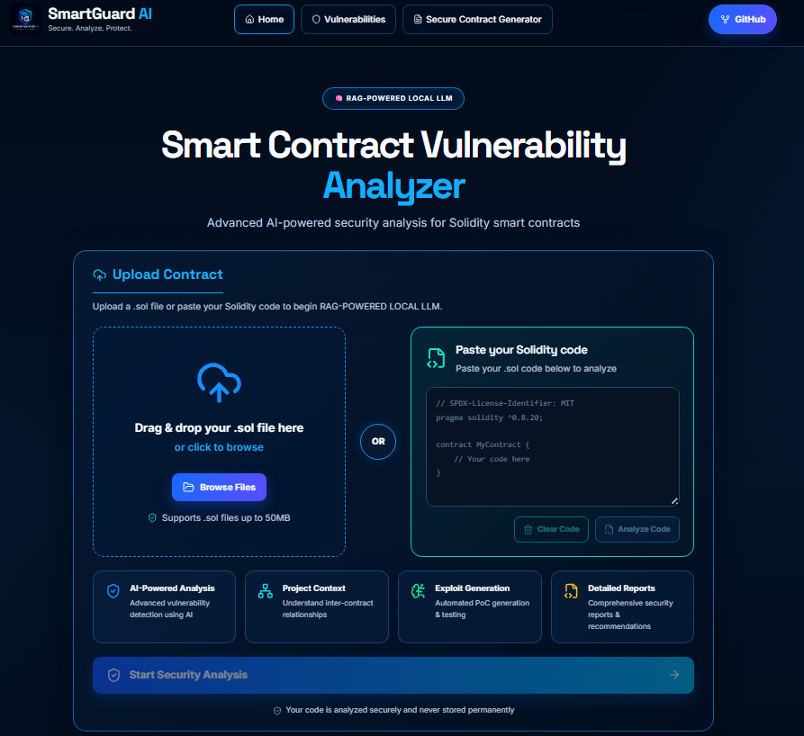
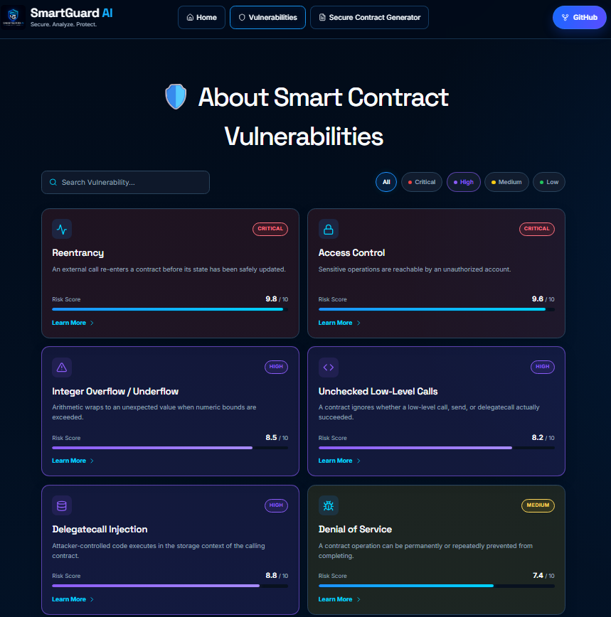
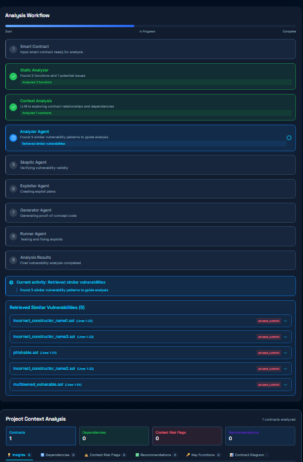
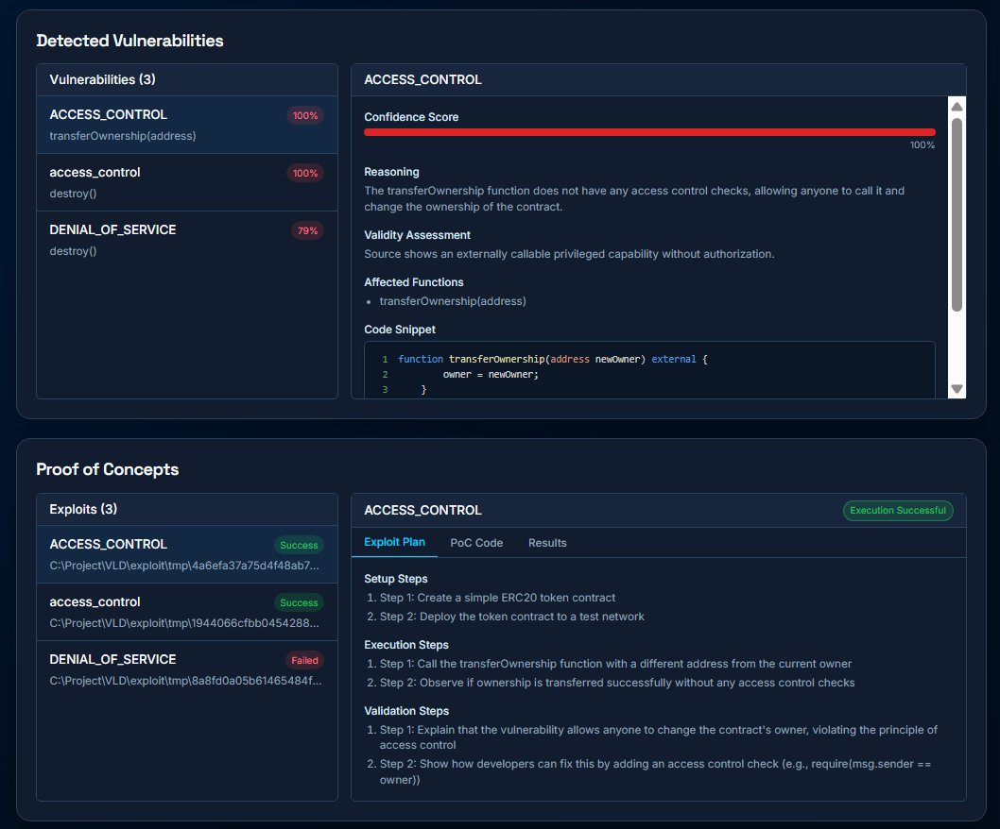
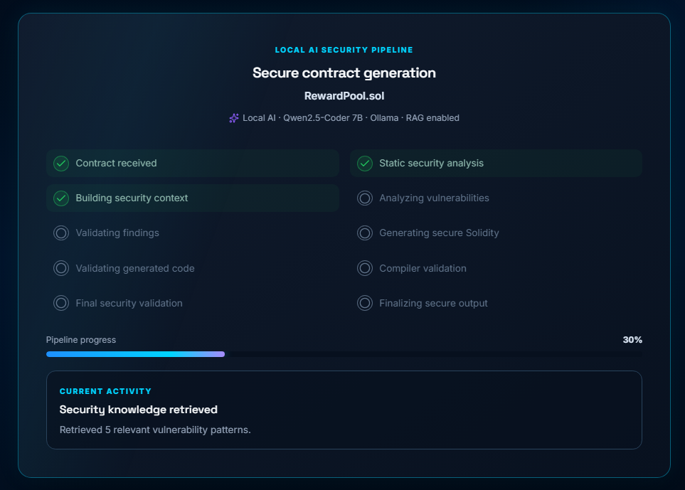

# 🛡️ SmartContractGuardian

> 🚀 A local-AI Solidity smart contract vulnerability detection, validation, proof-of-concept, and secure-revision platform.

SmartContractGuardian (VLD) combines Slither-based static analysis with source-grounded local LLM agents, retrieval-augmented security context, optional Foundry proof-of-concept execution, and a secure-contract generation workflow. It is designed to make Solidity review findings easier to inspect, verify, and act on without relying on a cloud LLM.

---

## 🌐 Project Links

- 🌍 Live Demo: [ADD LINK]
- 💻 GitHub Repository: https://github.com/sayeedur007-design/SmartContractGuardian
- 📚 Documentation: [ADD LINK]
- 🎥 Demo Video: [ADD LINK]

---

## 🧠 About The Project

Solidity contracts execute immutable value-bearing logic, so security issues can be expensive to correct after deployment. Manual review is essential but time-consuming; static analyzers are fast and repeatable but cannot by themselves provide complete project context, source-level reasoning, or remediation-oriented explanations.

SmartContractGuardian brings those signals together. A Flask backend accepts a Solidity file, pasted Solidity source, or a supported explorer-fetched contract. It uses Slither to extract function metadata, a call graph, and detector output. The local AI workflow then retrieves related examples from a Solidity vulnerability knowledge base, reasons over the supplied source and static evidence, and asks a second local agent to re-check the resulting findings.

The web application presents live agent status through Socket.IO, validated findings, optional exploit plans and PoC execution outcomes, project-context insights, and performance metrics. A separate secure-generator workflow produces a revised Solidity source only after its generated output passes deterministic checks, local compilation, and a final Slither validation pass.

## 🎯 Problem Statement

Smart contract reviews must identify flaws in access control, external calls, state changes, arithmetic, randomness, and application-specific logic before contracts are deployed. Reviewing every code path manually is difficult, while a static warning alone may lack the surrounding context needed to judge impact or remediation.

VLD addresses this by preserving the distinction between evidence types:

- Slither and source rules provide deterministic static evidence.
- Local LLM agents add source-grounded explanations and structured findings.
- A Skeptic agent independently re-checks findings and recalibrates confidence.
- Exploit plans and generated PoCs are hypotheses until a Foundry run records a successful execution.

The system is an analysis aid, not a substitute for a professional audit or a guarantee that a contract is secure.

---

## ✨ Core Features

### 🔍 Static analysis and contract intelligence

- Accepts `.sol` uploads and pasted Solidity code; the backend also supports fetching and flattening contracts from supported explorer networks.
- Runs Slither through `static_analysis.parse_contract.analyze_contract`.
- Extracts direct function declarations, function IDs, visibility, parameters, modifiers, source ranges, internal calls, a call graph, and registered Slither detector results.
- Selects a compatible local Solidity compiler path for legacy `0.4.x` source and otherwise uses compiler optimization arguments for Slither.
- Supports optional inter-contract context when a Solidity project directory is available.

### 🤖 Local AI-powered analysis

- Uses **Ollama** locally with **`qwen2.5-coder:7b`** for the Analyzer, Skeptic, Exploiter, Generator, Runner repair, and project-context roles.
- The Analyzer combines the contract source, function summary, Slither evidence, vulnerability category guidance, and retrieved knowledge snippets into a structured JSON review.
- Deterministic source rules are merged with LLM findings; findings are validated, deduplicated, and given source snippets.
- The Skeptic re-checks each proposed finding against the original Solidity source, evidence, and affected functions, returning verdicts and calibrated confidence. If the local response is unavailable or malformed, the implementation retains the existing analyzer evidence rather than silently reporting no findings.

### 🧠 Local RAG knowledge system

- Builds or reuses a persistent **ChromaDB** store in `chroma_db_v2` from the `known_vulnerabilities` corpus and `contract_vulns.json` manifest.
- Chunks known Solidity contracts with metadata such as source, line range, pragma, and vulnerability categories.
- Generates embeddings locally through **`nomic-embed-text`** using Ollama and LangChain's `OllamaEmbeddings` integration.
- Builds retrieval queries from externally callable functions and observed security signals, retrieves candidates, ranks them with category-aware evidence, and supplies the top relevant snippets to the Analyzer.
- RAG enriches the Analyzer prompt; retrieval results are not treated as findings about the uploaded contract by themselves.

### ⚔️ Exploitation analysis and PoCs

- For eligible re-checked findings, the Exploiter agent produces structured exploit plans with setup, execution, and validation steps.
- The Generator agent can produce Foundry Solidity PoCs and applies deterministic validation and compiler gating before persisting candidates.
- PoC generation can be skipped, leaving the exploit plan available without claiming an executable exploit exists.
- The standard analysis flow filters candidates by Skeptic confidence before optional PoC work. Generated plans and code remain distinct from validated execution results.

### 🧪 Verification and runner lifecycle

- The `ExploitRunner` compiles candidate PoCs, then executes tests in an isolated temporary Foundry workspace with copied sources and dependencies.
- It uses `forge build` for compile gating and `forge test` for execution, recording stdout, stderr, diagnostics, compilation status, execution status, traces, gas data when available, and timeout state.
- Failed candidates may receive bounded LLM-assisted repair attempts using compiler or execution diagnostics; repaired code is validated again before retrying.
- The runner reports `PASSED`, `FAILED`, `TIMEOUT`, or `ERROR` rather than treating generated code as a successful exploit.

### 🛠️ Secure smart-contract generation

- The Secure Contract Generator creates a job-specific Socket.IO room and emits real backend pipeline stages to the React UI.
- It repeats the secure analysis handoff internally: **Slither → local RAG-backed Analyzer → Skeptic → `rechecked_vulnerabilities`**.
- `GeneratorAgent.generate_secure_contract` receives the original source and the validated findings, requests complete Solidity only, normalizes mechanical generation artifacts, and applies deterministic security and generation-quality checks.
- If the first draft has blocking failures, it performs one targeted repair-generation pass and revalidates it.
- The accepted revision is compiled with local `solc` (with one safe normalization retry where applicable) and then analyzed with Slither again. A downloadable file is exposed only after compilation and final static validation pass.

### 📊 Analysis results and live workflow

- React views for live agent activity, RAG retrieval details, project-context insights, vulnerability findings, exploit/PoC details, and performance metrics.
- Socket.IO events communicate analysis state, active/completed agents, status detail, RAG context, and completion/error events.
- The Secure Generator has a stage-based progress dashboard with retry, failure, download, and “generate another” states. Progress reflects backend stages rather than a synthetic timer.

---

## 🏗️ System Architecture

```text
 React web client (React, Axios, Socket.IO client)
       │ upload / paste Solidity, start analysis, view results
       ▼
 Flask API + Flask-SocketIO  ───────────────► live job / generation events
       │
       ├── Contract upload or explorer fetch + flattening
       ▼
 Slither + local solc
       │ function_details · call_graph · detector_results
       ▼
 SocketIOAgentCoordinator / AgentCoordinator
       ├── ProjectContextLLMAgent (when a project directory is available)
       ├── AnalyzerAgent ◄── local RAG: known_vulnerabilities
       │                         │
       │                  nomic-embed-text via Ollama
       │                         ▼
       │                    ChromaDB (chroma_db_v2)
       └── SkepticAgent
                │
                ▼
       rechecked_vulnerabilities
          ├── ExploiterAgent → GeneratorAgent → optional Foundry Runner
          └── Secure Generator → validation/repair → solc → Slither → download

 All LLM agent roles use local Ollama with qwen2.5-coder:7b.
```

---

## 🔄 Analysis Pipeline

1. **Input and preprocessing** — A user uploads a Solidity file, pastes source into the web client, or uses the backend's supported contract-fetch route. JSON source bundles can be preprocessed into Solidity input.
2. **Static analysis** — Slither analyzes the contract or project and returns function details, a call graph, and detector output.
3. **Project context (when available)** — The project-context agent examines multiple Solidity files and their relationships. A single uploaded file follows a lightweight source-derived context path.
4. **RAG retrieval** — The Analyzer builds source/function-based queries, retrieves and ranks relevant known-vulnerability snippets from local ChromaDB, and uses them as context.
5. **Analyzer reasoning** — The local LLM produces structured candidate findings. Deterministic source/static rules are merged into that list, then findings are validated, deduplicated, and connected to snippets.
6. **Finding verification** — The Skeptic re-checks candidates against source evidence and assigns verdict/confidence information. The final list is `rechecked_vulnerabilities`.
7. **Optional exploitation workflow** — Eligible findings can receive an LLM-generated exploit plan and a generated Foundry PoC. The PoC is only an execution result if the runner records its compile/test outcome.
8. **Aggregation and presentation** — The backend stores job results and performance data; the frontend consumes Socket.IO updates and result endpoints to render findings, plans, PoC status, context, and metrics.
9. **Optional secure revision** — The secure-generator job internally builds validated findings, generates a revised contract, runs deterministic generation checks, allows one repair pass when needed, compiles it, and performs final Slither validation before download.

---

## 🛠️ Tech Stack

### 🎨 Frontend

- React 18 and React Router
- Axios
- Socket.IO Client
- Tailwind CSS and PostCSS
- Lucide React
- React Flow, Mermaid, and React Syntax Highlighter

### ⚙️ Backend

- Python 3
- Flask, Flask-CORS, and Flask-SocketIO
- Threaded in-memory analysis and secure-generation jobs
- Python Socket.IO / Engine.IO

### 🔐 Security analysis and execution

- Slither and Crytic Compile
- Local Solidity compiler (`solc`) and `solc-select`
- Foundry / Forge for generated PoC build and test execution
- Web3 and explorer-source fetching utilities for supported address-based input

### 🤖 Local AI and retrieval

- Ollama local runtime
- `qwen2.5-coder:7b` for agent reasoning, exploit planning, PoC generation, repair, project context, and secure contract generation
- `nomic-embed-text` for local embeddings
- LangChain, `langchain-ollama`, and `langchain-chroma`
- ChromaDB persistent vector store

---

## 📁 Project Structure

```text
VLD/
├── frontend_poc/
│   ├── app.py                     # Flask API, Socket.IO events, web-serving entry point
│   └── client/                    # React application
├── llm_agents/
│   ├── agent_coordinator.py       # Analysis workflow orchestration
│   ├── config.py                  # Local model and timeout configuration
│   ├── ollama_client.py           # Ollama-compatible client and readiness checks
│   └── agents/                    # Analyzer, Skeptic, Exploiter, Generator, Runner, context agents
├── static_analysis/               # Slither integration, detectors, call-graph support
├── rag/                           # ChromaDB ingestion and retrieval helpers
├── known_vulnerabilities/         # Vulnerability corpus and manifest
├── exploit/                       # Foundry project, generated PoC workspace, Forge configuration
├── utils/                         # Fetching, reporting, token, and helper utilities
├── examples/                      # Example contracts and sample outputs
├── tests/                         # Secure-generator and analyzer tests
├── benchmark_data/                # Benchmark inputs
├── benchmark_results/             # Saved benchmark outputs
├── performance_analysis/          # Stored performance metrics
├── chroma_db_v2/                  # Persistent active RAG vector store
├── main.py                        # CLI analysis entry point
├── requirements.txt               # Python dependencies
└── vulnerability_categories.json  # Analyzer category guidance
```

---

## 🚀 Getting Started

### Prerequisites

- Python 3 and the dependencies in `requirements.txt`
- Node.js and npm
- Ollama running locally with the configured models:

  ```bash
  ollama pull qwen2.5-coder:7b
  ollama pull nomic-embed-text
  ```

- Slither and a locally available Solidity compiler (`solc`)
- Foundry / Forge if you want generated PoCs to be compiled and executed

### Install dependencies

```bash
python -m venv .venv
# Activate the virtual environment for your shell
pip install -r requirements.txt

cd frontend_poc/client
npm install
```

### Build and run the web application

The Flask application serves the React production build from `frontend_poc/client/build`.

```bash
cd frontend_poc/client
npm run build

cd ..
python app.py
```

The backend is configured to run on `http://localhost:3000`.

### Run a CLI analysis

```bash
python main.py --contract path/to/Contract.sol
```

Useful CLI options implemented in `main.py` include `--no-rag`, `--skip-poc`, `--no-auto-run`, `--max-retries`, `--export-md`, and `--export-json`.

---

## 🔌 Key API Routes

| Method | Route | Purpose |
| --- | --- | --- |
| `POST` | `/api/upload-contract` | Upload a Solidity contract and create an analysis job. |
| `POST` | `/api/fetch-contract` | Fetch/flatten a supported explorer contract into an analysis job. |
| `POST` | `/api/analyze` | Start the configured analysis workflow. |
| `GET` | `/api/status/<job_id>` | Read analysis job status. |
| `GET` | `/api/results/<job_id>` | Retrieve completed analysis results. |
| `POST` | `/api/generate-secure-contract` | Start an asynchronous secure-contract generation job. |
| `GET` | `/api/secure-generations/<generation_id>` | Read secure-generation status and result data. |
| `GET` | `/api/secure-contracts/<generation_id>/download` | Download a successfully validated secure Solidity revision. |

---

## 📸 Platform Screenshots

These screenshots demonstrate the main SmartContractGuardian workflows, from contract analysis and security knowledge exploration to validated findings and secure-contract generation.

### 🏠 SmartContractGuardian Dashboard



---

### 📚 Vulnerability Knowledge Base



---

### 🔄 Analysis Workflow



---

### ⚠️ Vulnerability Findings & Proof of Concepts



---

### 🛠️ Secure Contract Generator



---

## ⚠️ Security and Usage Notes

- Treat findings, risk levels, generated plans, and generated code as review inputs. Validate important conclusions independently.
- A generated PoC is not proof of exploitability until its recorded Foundry execution succeeds.
- A secure revision is downloadable only after this project's deterministic checks, compilation, and final Slither validation; this is not a claim of absolute security.
- Keep local tooling and models installed and available. The secure-generator endpoint checks for `qwen2.5-coder:7b` and `nomic-embed-text` before running.

---

## 📄 License

No project license file is currently included in this repository.
